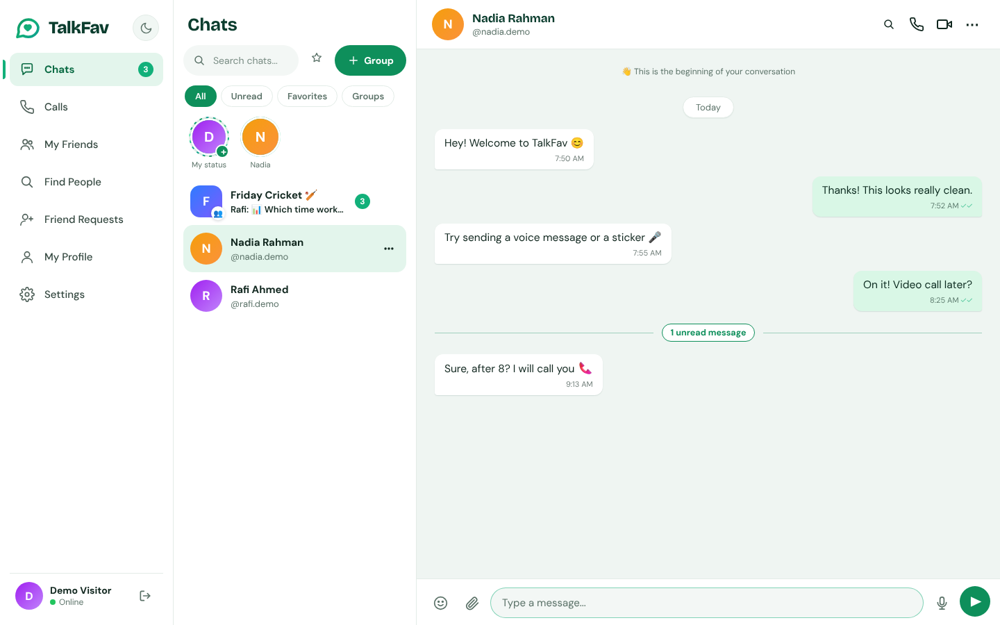
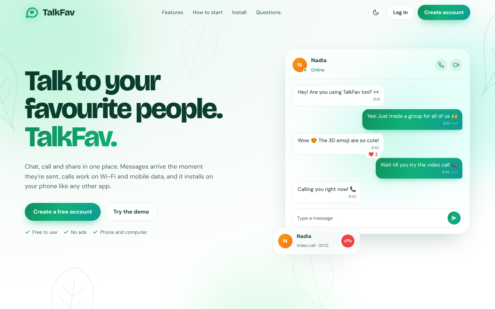
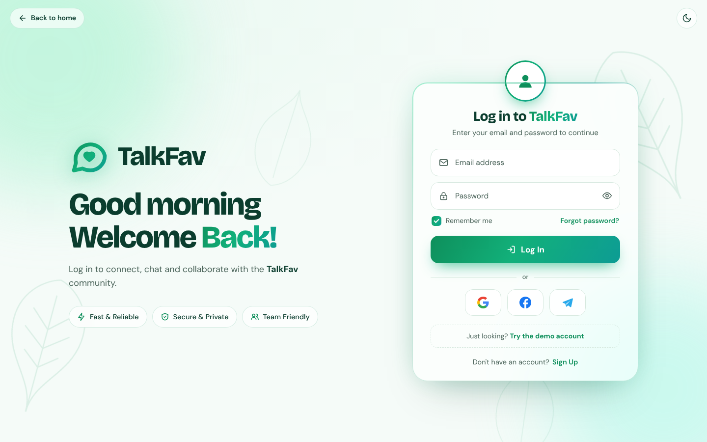
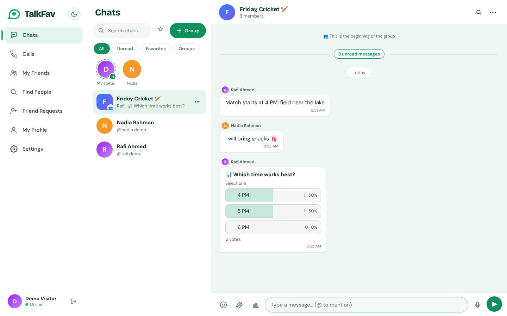
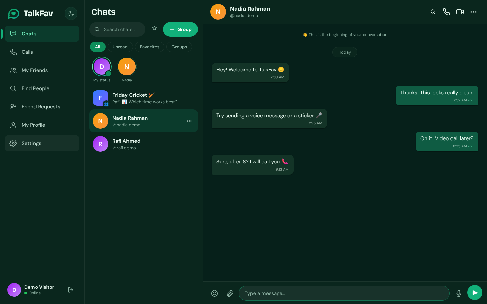
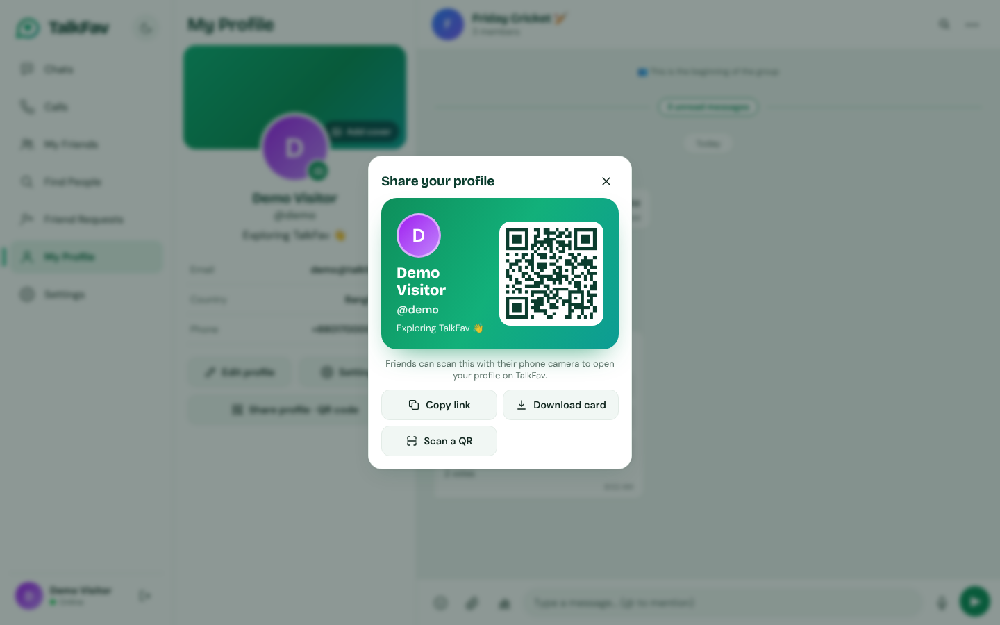
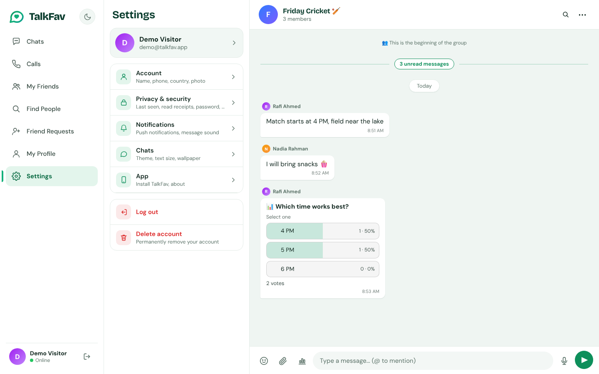
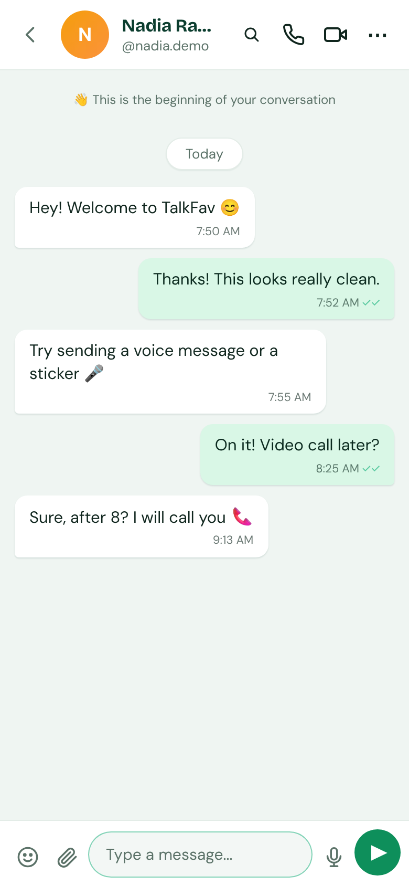
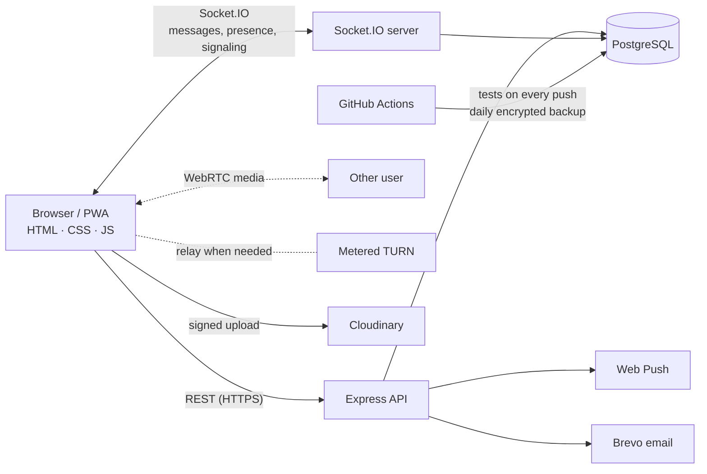

<div align="center">


# TalkFav

**A full-stack real-time messenger — chats, group chats, audio/video calls, file sharing and stories — built with Node.js, Socket.IO, PostgreSQL and WebRTC.**

[](https://github.com/Najiur11/talkfav_chat/actions/workflows/ci.yml)


### [🌐 Live app](https://talkfav-chat.onrender.com) · [👀 Try the demo (no sign-up)](https://talkfav-chat.onrender.com/index.html?demo=1)

<sub>Hosted on a free plan: the first load can take ~30 seconds while the server wakes up.</sub>



</div>

---

## Highlights

- **Real-time everything** — messages, typing indicators, read receipts, reactions, presence and edits arrive instantly over Socket.IO.
- **Audio & video calls** — WebRTC with STUN/TURN (works on mobile data), screen sharing, picture-in-picture, call quality indicator and automatic reconnection.
- **Installable app** — a Progressive Web App with push notifications, an offline page and home-screen icons.
- **Security first** — two-step verification (TOTP), login alerts for new devices, rate limiting, session management, SSRF protection and security headers.
- **Tested** — unit tests and API tests run against a real PostgreSQL database on every push (GitHub Actions).

## Screenshots

| Landing page | Login |
|---|---|
|  |  |

| Group chat with a poll | Dark mode |
|---|---|
|  |  |

| Profile QR code & digital card | Settings | Mobile |
|---|---|---|
|  |  |  |

## Features

<details open>
<summary><b>Messaging</b></summary>

- One-to-one and group chats with typing indicators and read receipts (✓✓)
- Reply, forward, copy, edit, unsend, delete for me, pin and save messages
- Reactions, 3D emoji, stickers and GIF search
- Voice messages, photos, videos and documents (drag & drop or paste)
- Link previews (including YouTube) and location sharing
- Drafts, unread divider, "jump to latest" with a new-message counter
- Select many messages to copy, forward or delete at once
- Multi-line messages (Shift + Enter), scheduled messages, disappearing messages
- Full-history search inside a chat, chat export, per-chat wallpapers
- Pin, archive, mute and favourite chats; filters for Unread, Favourites and Groups
</details>

<details>
<summary><b>Groups</b></summary>

- Admins and members, add/remove people, promote/demote admins
- Permissions (who can send messages, who can edit group info)
- @mentions with notifications, polls with live results, "seen by"
</details>

<details>
<summary><b>Calls</b></summary>

- Audio and video calls with mute, camera toggle, speaker and screen share
- TURN relay for strict networks and mobile data, ICE restart on network changes
- Call history with missed calls, ringtone and push notification for missed calls
</details>

<details>
<summary><b>People & profiles</b></summary>

- Friend requests, "People you may know" (mutual friends), block and report
- Unique @username, bio and links, profile and cover photos
- Personal QR code and downloadable digital profile card
- 24-hour statuses (text, photo or video) with view counts
</details>

<details>
<summary><b>Account, privacy & security</b></summary>

- Email/password and Google sign-in, password reset by email code
- Two-step verification with authenticator apps and one-time backup codes
- Email + push alert when the account is used on a new device
- Active sessions: see devices and log out remotely
- Hide online status / last seen, turn off read receipts, limit who sees your photo
- Rate limiting on login, registration, codes and APIs
- Delete account (removes messages and files)
</details>

<details>
<summary><b>App & admin</b></summary>

- PWA: install on phone and desktop, push notifications, offline page
- Light / Dark / System theme, adjustable text size, message sound toggle
- Admin panel: statistics, reports, ban/unban users, error log
- One-click demo account with sample chats (reset daily)
</details>

## Tech stack

| Layer | Technology |
|---|---|
| Backend | Node.js, Express 5, Socket.IO |
| Database | PostgreSQL (Aiven), `pg` |
| Real-time calls | WebRTC, Metered TURN |
| Frontend | HTML, CSS, vanilla JavaScript (no framework) |
| Files | Cloudinary (signed direct uploads) |
| Auth | bcrypt, HMAC-signed session tokens, Google OAuth, TOTP 2FA |
| Notifications | Web Push (VAPID), Service Worker |
| Email | Brevo |
| CI / Ops | GitHub Actions (tests + daily encrypted database backup), Render |

## Architecture



## Getting started

**Requirements:** Node.js 18+ and a PostgreSQL database.

```bash
git clone https://github.com/Najiur11/talkfav_chat.git
cd talkfav_chat
npm install
cp .env.example .env    # then fill in the values (see below)
npm start               # http://localhost:3000
```

Tables are created automatically on the first start.

### Environment variables

| Variable | Required | Purpose |
|---|---|---|
| `DATABASE_URL` | ✅ | PostgreSQL connection string |
| `JWT_SECRET` | ✅ | Secret used to sign session tokens |
| `CLOUDINARY_CLOUD_NAME`, `CLOUDINARY_API_KEY`, `CLOUDINARY_API_SECRET` | | File and photo sharing |
| `METERED_USERNAME`, `METERED_PASSWORD` | | TURN server for calls on mobile data |
| `VAPID_PUBLIC_KEY`, `VAPID_PRIVATE_KEY`, `VAPID_SUBJECT` | | Push notifications |
| `GOOGLE_CLIENT_ID` | | "Continue with Google" |
| `BREVO_API_KEY`, `MAIL_FROM` | | Password reset and login alert emails |
| `GIPHY_API_KEY` | | GIF search |
| `ADMIN_EMAILS` | | Comma-separated emails that get the admin panel |

Features whose keys are missing are turned off gracefully; the server prints a warning.

## Testing

```bash
npm test                                   # unit tests
DATABASE_URL_TEST=postgres://... npm test  # + API tests against a test database
```

The API tests start the real server against an empty database and cover registration and validation, login, sessions, friend requests, private chats, group permissions, SSRF protection, rate limiting, two-step verification and the demo account. GitHub Actions runs them on every push with a PostgreSQL service container.

## Project structure

```
├── server.js              # Express API + Socket.IO + database setup
├── lib/                   # Small, tested helpers (TOTP, network safety)
├── tests/                 # node:test unit and API tests
├── landing.html           # Marketing page (served at /)
├── index.html             # Login        register.html  # Sign up
├── dashboard.html         # The app
├── privacy.html           # Privacy policy
├── assets/
│   ├── Css/               # landing.css, auth.css, dashboard.css
│   ├── js/                # dashboard.js, call.js, auth.js, pwa.js ...
│   ├── emoji/ stickers/   # Self-hosted 3D emoji and stickers
│   └── icons/             # PWA icons
├── sw.js                  # Service worker (offline + push)
├── docs/                  # Backup guide and screenshots
└── .github/workflows/     # CI and daily database backup
```

## Security notes

- Passwords are hashed with bcrypt; sessions are server-side and can be revoked.
- Two-step verification uses RFC 6238 TOTP with backup codes stored as hashes.
- Link previews block private, loopback and cloud-metadata addresses (SSRF) and re-check every redirect.
- Rate limits protect login, registration, verification codes, previews and searches.
- Security headers: `X-Frame-Options`, `X-Content-Type-Options`, `Referrer-Policy`, `Permissions-Policy`, HSTS; CORS limited to the app's own origins.
- Database backups are encrypted with AES-256 before leaving the server. See [docs/BACKUP.md](docs/BACKUP.md).

## Roadmap

- AI features: smart replies and chat summaries
- Message translation
- Group video calls (needs a media server)

---

<div align="center">

Made by **[Najiur](https://github.com/Najiur11)** · [Privacy policy](https://talkfav-chat.onrender.com/privacy.html)

</div>